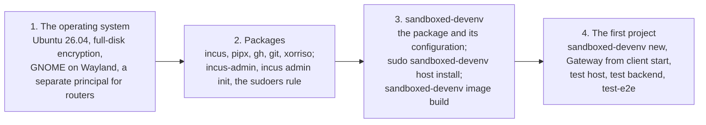

# The Linux laptop, day one

The steps that take a fresh Framework Laptop 13 Pro from the box to the first project opened
in a sandboxed IDE, with the laptop as the control machine and its own client host and Incus
driving the backend VMs (PLAN.md, M5). Written before the laptop arrived; the items marked "to
confirm" are what its first run settles.

Four stages, each a section below:



## 1. The operating system

1. Ubuntu 26.04 (what Framework certifies for the 13 Pro, and the release the VMs run, so the
   AppArmor profiles, pipx 1.8.0 and the kernel match). Full-disk encryption. No separate
   volume: the Incus pool is a directory on the root filesystem, so only free space matters,
   and the filesystem type does not (PLAN.md, "Incus storage").
2. Your login is the development user. Anything that touches routers lives in a separate
   principal, an operations user or a VM (summary, section 5), never in this one.
3. The desktop session is GNOME on Wayland (the default). The client sandbox needs the Wayland
   socket and nothing else.

## 2. Packages

```sh
sudo apt install incus pipx gh git xorriso
sudo adduser "$USER" incus-admin        # then log out and in again
incus admin init                          # defaults are fine: a dir pool, a managed bridge incusbr0 with NAT
```

`incus admin init` makes the default pool and `incusbr0`. The tool uses its own `dir` pool,
`sandboxed-devenv`, which `host install` creates on `incus.storage_dir` when that is set in
`config.yaml`, else in Incus's own location. `xorriso` (or `genisoimage`) writes the seed
ISOs; `qemu-utils` is not needed on Incus, which imports the cloud image as downloaded.

Two commands of the tool run as root through `sudo` on the client host it is itself: `host
install`, and `connect add` and `connect rm`, which `new` and `rm` call. For `new` and the
harnesses to run without a password prompt (the M4 gate says unattended), allow that one
command and nothing else:

```sh
echo "$USER ALL=(root) NOPASSWD: /usr/local/bin/sandboxed-devenv" | sudo tee /etc/sudoers.d/sandboxed-devenv
sudo chmod 440 /etc/sudoers.d/sandboxed-devenv
```

## 3. sandboxed-devenv

### The package and its configuration

```sh
gh auth login                             # the browser flow; then let git use the same login
gh auth setup-git
git clone https://github.com/jeffsw/sandboxed_devenv.git ~/proj/ide_sandbox/sandboxed_devenv
sudo pipx install --global ~/proj/ide_sandbox/sandboxed_devenv
mkdir -p ~/.sandboxed_devenv/secrets && chmod 700 ~/.sandboxed_devenv/secrets
cat > ~/.sandboxed_devenv/config.yaml <<'YAML'
client_host: local
incus:
  storage_dir: /var/lib/sandboxed-devenv/incus   # optional; omit for Incus's default location
YAML
cp ~/proj/ide_sandbox/sandboxed_devenv/sandboxed_devenv/policy.yaml ~/.sandboxed_devenv/policy.yaml
```

Edit the copied `policy.yaml`: `uplink_interface` is the laptop's interface toward the
Internet (`ip route show default` names it); `vm_subnet` is `incusbr0`'s subnet
(`incus network get incusbr0 ipv4.address`, without the host part). Leave `enforce: false`
until the ruleset has been watched working. Then:

```sh
claude setup-token > /dev/null            # paste the token into ~/.sandboxed_devenv/secrets/claude_oauth_token
sandboxed-devenv doctor
```

The token can also be the Mac's: copy `~/.sandboxed_devenv/secrets/claude_oauth_token` over
with `scp`, mode 0600. The key pairs are not copied; the laptop mints its own.

`doctor` should say control: yes (incus), client host: not provisioned, the secrets and the
GitHub login.

### The client host

```sh
sudo sandboxed-devenv host install
```

The `gw` user, its files, the AppArmor profiles, sysctl, the nftables ruleset (installed,
not enabled), the Gateway launcher, the sandbox key as gw's, and the Incus pool. Log out and
in, then in the GNOME session `sandboxed-devenv client start` runs Gateway as `gw`, and
`sandboxed-devenv host check` runs the canary there (expect 0 FAIL).

To confirm: the AppArmor profiles load on the laptop's kernel and the client's embedded
browser works under Ubuntu's user-namespace restriction, as they do on desk.

### The base image

```sh
sandboxed-devenv image build              # Ubuntu's cloud image imported into Incus, booted once, published
```

The first real run of the Incus driver. To confirm, in this order: the imported cloud image
boots as a VM (UEFI, secure boot on); cloud-init finds the seed ISO attached as a disk device
by its `cidata` label; the static lease on `incusbr0` gives the build VM the address the
control side pinned its host key under; `incus publish` keeps the image as an alias.

## 4. The first project

```sh
sandboxed-devenv new PROJECT --repo OWNER/REPO
sandboxed-devenv test host
sandboxed-devenv test backend PROJECT
mise run test-e2e                         # from the checkout
```

In Gateway, started by `sandboxed-devenv client start` in the GNOME session, the project's
connection is listed and `/home/dev/proj/PROJECT` opens. To confirm here: `incus init` from
the alias, `incus copy` for `clone`, and the egress ruleset on the bridge once `enforce` is on.
Record the timings in the summary (step 6 of 4.9).

## Differences from the Mac rig

- No desk: the laptop is the client host, so `client-host` commands refuse to run and `connect
  add` writes gw's files locally through `sudo`.
- Backends take DHCP from `incusbr0` with a static lease; the seed carries no network-config
  and there are no half-subnet routes.
- A clone is a full copy on a `dir` pool (no reflinks on ext4), reported as a slow step.
- The nftables ruleset covers both halves: the forward chain for the VMs on the bridge and the
  output chain for `gw`. Incus manages its own firewall rules for the bridge; if the two fight,
  Incus network ACLs are the alternative (PLAN.md, M5).
