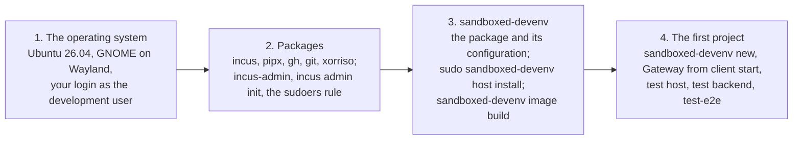

# A Linux machine, day one

The steps from a fresh Linux install to the first project opened in a sandboxed IDE, on a
machine that plays every role itself: the control side, the client host where the IDE's thin
client runs in its sandbox, and the hypervisor, Incus, for the backend VMs (PLAN.md, M5). A
laptop is the usual case, but nothing here depends on the hardware. The items marked "to
confirm" have not been exercised on Incus yet and are what a first run settles.

Four stages, each a section below:



## 1. The operating system

1. Ubuntu 26.04, the release the VMs run, so the AppArmor profiles, pipx and the kernel
   features the sandbox relies on are the same on both sides. Other distributions are not
   tested. Any disk layout will do: the Incus pool is a directory on an existing filesystem,
   so only free space matters, and the filesystem type does not (PLAN.md, "Incus storage").
   Count on about 10 GB for the base image and the downloaded cloud image, plus whatever each
   backend grows to.
2. Your login is the development user. Credentials that have nothing to do with development
   stay out of it, in another user or a VM (summary, section 5).
3. The desktop session is GNOME on Wayland, Ubuntu's default. The client sandbox needs the
   Wayland socket and nothing else; an X11 session will not do.

## 2. Packages

```sh
sudo apt install incus pipx gh git xorriso
sudo adduser "$USER" incus-admin        # then log out and in again
incus admin init                          # defaults are fine: a dir pool, a managed bridge incusbr0 with NAT
```

`incus admin init` makes the default pool and `incusbr0`. The tool uses its own `dir` pool,
`sandboxed-devenv`, which `host install` creates on `incus.storage_dir` when that is set in
`config.yaml`, else in Incus's own location. `xorriso` (or `genisoimage`) writes the seed
ISOs; `qemu-utils` is not needed on Incus, which imports the cloud image as downloaded.

Two commands of the tool run as root through `sudo` on the client host it is itself: `host
install`, and `connect add` and `connect rm`, which `new` and `rm` call. For `new` and the
harnesses to run without a password prompt (the M4 gate says unattended), allow that one
command and nothing else:

```sh
echo "$USER ALL=(root) NOPASSWD: /usr/local/bin/sandboxed-devenv" | sudo tee /etc/sudoers.d/sandboxed-devenv
sudo chmod 440 /etc/sudoers.d/sandboxed-devenv
```

## 3. sandboxed-devenv

### The package and its configuration

```sh
gh auth login                             # the browser flow; then let git use the same login
gh auth setup-git
git clone https://github.com/jeffsw/sandboxed_devenv.git ~/proj/ide_sandbox/sandboxed_devenv
sudo pipx install --global ~/proj/ide_sandbox/sandboxed_devenv
mkdir -p ~/.sandboxed_devenv/secrets && chmod 700 ~/.sandboxed_devenv/secrets
cat > ~/.sandboxed_devenv/config.yaml <<'YAML'
client_host: local
git:                                             # the identity for commits inside the backends;
  user_name: Your Name                           # or `git config --global user.name` and `user.email`
  user_email: you@example.com
incus:
  storage_dir: /var/lib/sandboxed-devenv/incus   # optional; omit for Incus's default location
YAML
cp ~/proj/ide_sandbox/sandboxed_devenv/sandboxed_devenv/policy.yaml ~/.sandboxed_devenv/policy.yaml
```

Edit the copied `policy.yaml`: `uplink_interface` is the machine's interface toward the
Internet (`ip route show default` names it); `vm_subnet` is `incusbr0`'s subnet
(`incus network get incusbr0 ipv4.address`, without the host part). Leave `enforce: false`
until the ruleset has been watched working. Then:

```sh
claude setup-token > /dev/null            # paste the token into ~/.sandboxed_devenv/secrets/claude_oauth_token
sandboxed-devenv doctor
```

The token can also come from another machine that already has one: copy
`~/.sandboxed_devenv/secrets/claude_oauth_token` over with `scp`, mode 0600. The key pairs are
not copied; each control machine mints its own.

`doctor` should say control: yes (incus), client host: not provisioned, the secrets and the
GitHub login.

### The client host

```sh
sudo sandboxed-devenv host install
```

The `gw` user, its files, the AppArmor profiles, sysctl, the nftables ruleset (installed,
not enabled), the Gateway launcher, the sandbox key as gw's, and the Incus pool. Log out and
in, then in the GNOME session `sandboxed-devenv client start` runs Gateway as `gw`, and
`sandboxed-devenv host check` runs the canary there (expect 0 FAIL).

To confirm: the AppArmor profiles load and the client's embedded browser works under Ubuntu's
user-namespace restriction, as they do on the Mac rig's desk VM.

### The base image

```sh
sandboxed-devenv image build              # Ubuntu's cloud image imported into Incus, booted once, published
```

The first real run of the Incus driver on a machine confirmed, 8 November 2026: the imported
cloud image boots as a VM (UEFI, secure boot on); cloud-init finds the seed ISO attached as a
disk device by its `cidata` label (`/dev/sr0`); the static lease on `incusbr0` gives the build
VM the address the control side pinned its host key under; `incus publish` keeps the image as
an alias. Timings there: the cloud image downloaded in 40 s, cloud-init 98 s, publish 3 min
20 s, 6 min 17 s in all.

## 4. The first project

```sh
sandboxed-devenv new PROJECT --repo OWNER/REPO
sandboxed-devenv test host
sandboxed-devenv test backend PROJECT
sandboxed-devenv test end-to-end          # `mise run test-e2e` from a checkout that has mise
```

In Gateway, started by `sandboxed-devenv client start` in the GNOME session, the project's
connection is listed and `/home/dev/proj/PROJECT` opens. Confirmed on the same machine:
`incus init` from the alias (a backend ready in 49 s, 34 s of it the init), `resources`
changing CPUs and memory on the running VM, and `clone` through a temporary published image
(4 min 26 s, the publish most of it), since `incus copy` of a VM on a `dir` pool failed in the
`dd` it runs with direct I/O. Still to
confirm: the egress ruleset on the bridge once `enforce` is on. Record the timings in the
summary (step 6 of 4.9).

## Differences from the Mac rig

- No desk: the machine is its own client host, so `client-host` commands refuse to run and
  `connect add` writes gw's files locally through `sudo`.
- Backends take DHCP from `incusbr0` with a static lease; the seed carries no network-config
  and there are no half-subnet routes.
- A clone is a full copy on a `dir` pool (no reflinks on ext4), reported as a slow step.
- The nftables ruleset covers both halves: the forward chain for the VMs on the bridge and the
  output chain for `gw`. Incus manages its own firewall rules for the bridge; if the two fight,
  Incus network ACLs are the alternative (PLAN.md, M5).
