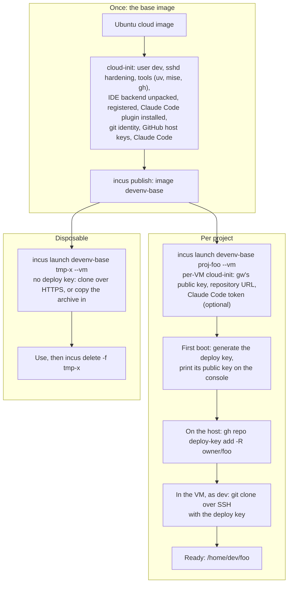
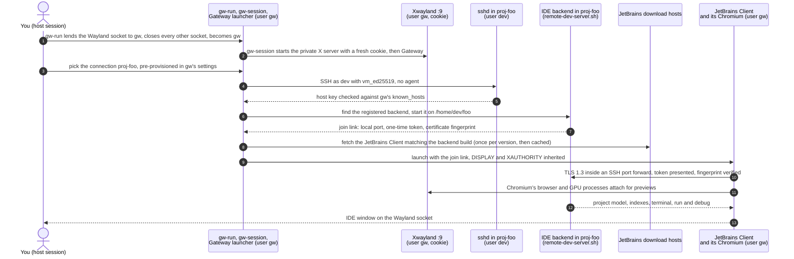
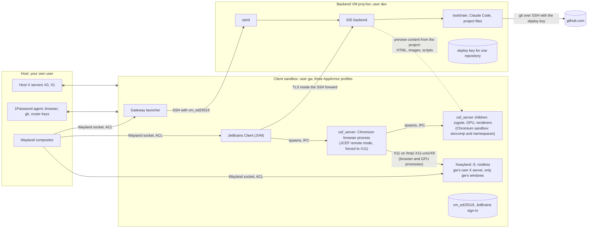
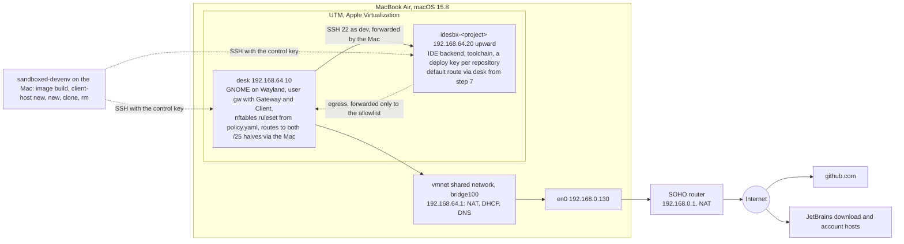

# Keeping an IDE away from your keys: options summary and decision notes

Updated 8 November 2026, revision 13. This is the design record for the sandboxed development environment, organised around the design chosen on 8 October: **JetBrains Gateway with its thin client in a small sandbox and the IDE backend in a virtual machine, one VM per project or a disposable one.** The rehearsal rig of 4.9 is built and its first two steps passed on 9 October: the JetBrains Client and the Gateway launcher both run on the Wayland toolkit as a second Unix user under GNOME. Everything else is untested. Figures were read from GitHub, npm, JetBrains documentation and the Mac itself on 7 to 9 October and will go stale. The earlier brainstorming document in this repository, `ide_sandboxing.html`, is kept for history only; what it contributed is restated or cited directly here.

## Revision history

- Revision 13 (8 November, later): two key pairs instead of the rig key: `control_ed25519` for the control side into desk and the backends, `sandbox_ed25519` for `gw` into the backends only, after noticing that one pair let `gw` log into `desk` as its sudo-capable user. Every VM's SSH host key is minted by the control side into its cloud-init seed and pinned before boot, so no connection trusts a key on first use. Deploy keys are registered and revoked through `gh` by `new`, `rm`, `repo` and `creds` (M3). 4.9 and section 5 follow.
- Revision 12 (8 November): 4.9 rewritten for the package. The rig scripts under `rehearsal/utm/` are gone; `sandboxed-devenv image build`, `client-host new`, `new`, `clone` and `rm` do what they did, with one backend VM per project at an address from a pool, routes to both halves of the VM subnet on `desk`, the connection written for `gw` and Gateway by `connect add`, and an inventory under `~/.sandboxed_devenv/`. The egress policy moved to `policy.yaml`; only address ranges reach the ruleset, since nft refuses a host name that resolves to several addresses. Registering deploy keys on GitHub is the one manual step left (PLAN.md, M3).
- Revision 11 (17 October): the repository gained `mise run verify` and a GitHub Actions workflow that runs it on every push: the seeds are rendered without building ISOs, then checked with `cloud-init schema`, the AppArmor and nftables parsers, shellcheck, ruff, yamllint, actionlint, this document's house rules and a render of each Mermaid diagram. The client AppArmor profiles lose their `@{exec_path}` rule, which only AppArmor 5 declares. The "Fresh VMs" block in 4.9 now revokes and re-registers the deploy key, which a rebuilt backend mints anew.
- Revision 10 (9 October, evening): a consolidated pass after a day in the rig. The backend template now installs the everyday tools, `gh` from GitHub's repository, the Claude Code plugin, GitHub's host keys, a git identity and Claude Code's settings with an optional token from `keys/`; the desk template gives the private X server an authorization cookie; the canary checks the SSH client config; the start-up diagrams show `gw-session`, the X server and the pre-provisioned connection. Findings of the day recorded in 4.3, 4.4, 4.5 and 4.9: the embedded browser's needs, the key-access dialog, plugin staging, the settings-file trap, the login callback.
- Revision 9 (9 October): the rehearsal rig was built and debugged on the Mac (findings recorded in 4.9: UTM's sandbox and scripting gaps, the dracut and NetworkManager interaction, VM isolation on the shared network), and steps 1 and 2 of 4.9 passed: GNOME accepts the second user's Wayland connection, the 2026.2.3 client reports `sun.awt.wl.WLToolkit`, and so does the Gateway launcher with its one VM options line. Open questions answered accordingly; Gateway's stored SSH connection added to the desk template. The canary script was written and run in both roles; its first run showed the second user could reach D-Bus, PipeWire and other sockets in the real user's runtime directory, so `gw-run` now closes them with ACLs (4.3). The embedded browser turned out to need both an X display and an AppArmor profile on the launcher (4.3).
- Revision 8 (8 October): the "VM per trust zone" option is dropped; per-project and disposable VMs cover every case (4.7). The credential clean-up on the host moves from step 1 to a hardening step at the end, because the rehearsal mints its own keys and never touches the host's (section 5, section 8). New: a start-up walkthrough with diagrams (4.8), the rehearsal rig on the Mac with cloud-init files in `rehearsal/utm/` and a network diagram (4.9), and a check that the current Mac can run it. References to the earlier HTML brainstorming document are removed; its sources are cited directly.
- Revision 7: agent sandboxing inside the backend VM, and the egress proxy that goes with it, moved out of the main plan into Deferred work.
- Revision 6: section 3 reorganised by the part each tool plays. The Toolbox App, which JetBrains names as Gateway's successor, examined in 4.2 and found X11-only. The Gateway launcher needs one VM options line for Wayland (4.6).
- Revision 4: the thin client's Wayland support checked against the builds JetBrains ships rather than the blog. Clients from 2026.2 select Wayland automatically.
- Revisions 1 to 3: the threat split into three cases (section 1); the split model adopted, since its usual objection, that the backend can reach the client, disappears when the client runs as a low-value principal; the Flatpak IntelliJ manifest read from Flathub (4.3); `sandbox-runtime` examined and found not to be an IDE sandbox; credential findings from the Mac recorded (section 5).

## 1. Three threats, three answers

| Threat | Example | Right answer | Engineering needed |
|---|---|---|---|
| Code from a stranger | Recruiter take-home, "review my repo" | Disposable VM with no shared folders, or a cloud environment in the browser. Delete afterwards. | None today (UTM on the Mac). With Gateway, a disposable clone of the backend image (section 4.7). |
| Compromised dependency in a project you work in daily | npm or PyPI package, Gradle plugin, a Git hook in a repo you cloned | Persistent backend VM per project, per-project credentials, egress allowlist, sandboxed client | This is the project. Sections 2 to 4. |
| Misled AI agent | Instructions planted in a README or comment steer Claude Code or the JetBrains assistant | Same as above, plus the agent's own sign-in and tool list kept small | The backend VM, where the agent runs. A second sandbox around the agent inside the VM is deferred work. |

The premise: opening a project is enough to run its code. VS Code tasks, Gradle and Maven sync, package install hooks and language servers all execute project code before you type anything. The IDE's own trust prompts (VS Code workspace trust with `task.allowAutomaticTasks` off, JetBrains Safe Mode for untrusted projects) reduce the automatic surface and cost nothing, but they are not a boundary.

## 2. Target architecture

```
Host: compositor, 1Password agent with an allowlist, hardware-backed keys, browser, router access
 │
 ├── Client sandbox (second Unix user, Bubblewrap, or a local Flatpak of the Gateway tarball): one for your projects, one for disposable VMs
 │     JetBrains Gateway launcher + JetBrains Client. Sees the Wayland socket and its own small home.
 │     Holds: the JetBrains account sign-in and an SSH key that opens only the backend VMs.
 │     Egress: the VM subnet and the JetBrains download and account hosts. Nothing else.
 │
 └── Backend VMs: one per project, cloned from a base image; disposable clones for stranger code
       IDE backend, indexing, builds, tests, toolchains, Claude Code, project code.
       Holds: a per-project deploy key or fine-grained token. (Holding none at all is deferred work.)
       Egress: NAT with an nftables or Incus ACL allowlist, or only a proxy on the host.
```

Why this design:

- **Kernel boundary where the hostile code runs.** The backend VM is the thing that executes project code, and it has its own kernel. A whole-IDE namespace sandbox shares the host kernel with the hostile code.
- **Native window without Wayland-socket recipes for the whole IDE.** Only the thin client needs the socket. The client is a JetBrains app, so the same sandbox recipes apply, but it is smaller and it never runs project code.
- **A vendor-supported product on both sides.** JetBrains Remote Development over SSH is documented and maintained. The community Wayland-in-container recipes are not.
- **The trusted link is harmless.** JetBrains says information may be forwarded either way without user interaction. Forwarding into a sandbox that holds nothing is fine. SSH agent forwarding stays off in the client.

Costs: memory for several VMs (the Framework's 64 GB covers four or five running at once), the thin client's feature set, which lags the local IDE in places, and a version floor of 2026.2 for the client's native Wayland support (section 4.6). The first two are testable in a day.

Variant for later: Intel's Xe driver is adding SR-IOV GPU virtualization for Panther Lake, which the Framework 13 Pro uses. If it lands in the distribution kernel, a VM can get real GPU acceleration, which makes "whole IDE in the VM, shown through the VM console or waypipe" viable too. Not needed for the Gateway design, where the backend never draws.

## 3. Option catalogue

The chosen design (section 4) is assembled from parts, and most tools that get called "sandboxes" fit only one part. The parts:

- **Client sandbox:** holds the Gateway launcher and the JetBrains Client, draws on the host desktop, and must see only the Wayland socket and its own home.
- **Backend:** runs the IDE backend, toolchains, the agent and the project code. This is the part that needs a kernel boundary.
- **Egress control:** decides what leaves the backend and which credentials reach it.
- **Agent layer:** an optional second sandbox around the agent's commands inside the backend. Deferred work, listed here only so the catalogue is complete.

Bubblewrap, ai-jail and jailbee are often presented as complete answers. Below, each candidate is placed where it fits.

### 3.1 Client sandbox candidates

| Candidate | How it isolates | Display | What the client sees | Verdict |
|---|---|---|---|---|
| Second Unix user | File permissions and per-UID firewall rules; same kernel and compositor | Host Wayland socket shared with `setfacl` | Its own home; nothing of yours unless copied in | **Try first.** Simplest, and the egress rules are trivial. Needs the compositor to accept a connection from another UID: verified on GNOME 50 (Mutter) on 9 October, reported working on Sway, untested on KDE. Needs deny ACLs on everything else in the runtime directory (4.3). |
| Bubblewrap script | Namespaces with a policy you write; runs as you | You bind the socket in yourself | A fresh home with only what you bind | **Second.** Molodetskikh's script is the starting point. Needs the embedded-Chromium property (4.3). |
| Local Flatpak of the Gateway tarball | Bubblewrap under Flatpak's policy, from a manifest you write | `--socket=wayland` only | Private config and data under `~/.var/app/<id>`; the real home never granted | **Third.** Adds Flatpak's override system and the Wayland security-context marking. Per-app egress rules need cgroup matching because it runs as your UID. |
| ai-jail | Bubblewrap plus Landlock and seccomp, ready-made | `--display` binds only the Wayland socket | A fresh in-memory home; SSH only with `--ssh` | Built for terminal agents. Nobody has run a graphical client under it; an estimate of a few hours is optimistic. |
| Flatpak IntelliJ from Flathub, with overrides | Same mechanism as the row above, community manifest | `--socket=wayland` plus `fallback-x11`, so no X11 socket in a Wayland session | Private app data, but the real home, both agent sockets, the GPU and IPC are granted until removed with `flatpak override --user --nofilesystem=home --nosocket=ssh-auth --nosocket=gpg-agent --nosocket=fallback-x11 --unshare=ipc` | Only if the full IDE must run locally; Flathub has no Gateway package. Its value here is as the working precedent for a JetBrains app on a Wayland socket alone (4.3). |

Not a client sandbox: `sandbox-runtime`, which has no display code (the reasons are under Deferred work); Toolbx and Distrobox, which are not a boundary at all, as Fedora's own documentation says; and Dev Containers or Remote Development used as shipped, where the client runs as you, which is the problem this design fixes.

### 3.2 Backend candidates

| Candidate | Boundary | Verdict |
|---|---|---|
| VM per project, cloned from a base image, with disposable clones for stranger code | Separate kernel | **Chosen.** Incus as the manager (4.7). |
| Podman or Incus container with the backend inside | Namespaces and a separate userland; shares the host kernel | Lighter than a VM and Gateway connects the same way. A kernel bug is a way out. |
| jailbee | Incus containers per branch with Docker nested inside; shares the host SSH and GPG agents by design | Read for ideas, do not depend on it (3.5). |
| VM with the full IDE inside, windows forwarded by `waypipe` over vsock | Separate kernel | Fallback if the thin client disappoints. Rendering glitches with a full IDE are the risk. |

### 3.3 Egress control and the agent layer (the last two rows are deferred)

| Candidate | What it gives | Verdict |
|---|---|---|
| Hypervisor NAT with an `nftables` or Incus ACL allowlist | A per-VM allowlist by address | **First phase.** Simple; no names, no credential handling. |
| `srt proxy` on the host with a decider | Per-request allow by name, TLS termination, credentials injected so the VM holds none | Deferred work. You write the decider; Git over HTTPS only. |
| `srt` inside the VM around the agent or builds | A per-command allowlist, violation logs, write blocks on hooks and rc files | Deferred work. A Fedora guest avoids its Ubuntu issues. |

### 3.4 Whole-system alternative

Qubes OS is this design as a finished operating system: a Xen VM per activity, split SSH and GPG, a firewall per qube, and no GPU acceleration. Check its hardware list for the Framework 13 Pro first; brand-new laptops usually wait. Not recommended now (section 7).

### 3.5 Maturity of the third-party tools

Figures read from GitHub on 7 October, `srt` on 8 October.

| Tool | Stars | Commit authors | Age and pace | Note |
|---|---|---|---|---|
| Bubblewrap | 8.5k | 78 | Since 2016, steady | In every distribution; Flatpak's engine |
| ai-jail | 1.1k | 37, one wrote most | Since March 2026, changes daily | |
| jailbee | 3 | 6, one wrote almost all | Since August 2026 | |
| `sandbox-runtime` | 5.5k | 45, Anthropic staff wrote most | Since October 2025, still 0.0.x | 151 open pull requests, 114 open issues |

## 4. JetBrains Gateway in detail

### 4.1 The pieces and what runs where

JetBrains describes Gateway as "a lightweight launcher that connects a remote server with your local machine, downloads backend components, and opens the project in JetBrains Client". Three processes matter:

- **JetBrains Gateway** is the launcher. It manages connections and, after you pick a host, downloads and starts the client that matches that host's backend. Its window hides to the tray by default.
- **JetBrains Client** is the UI, one process per environment. "The JetBrains Client's version is always equal to the version of the backend IDE." It is built on the IntelliJ platform and imports local IDE settings it finds on the client machine. Plugins on the client are limited to those that change the UI, keymaps and themes; "JetBrains Client is not designed to be extensible for the connection part." Functional plugins run on the backend and carry an "On Host" label, and the parts of a plugin that belong on the client are installed there. That last point matters for the design: **the backend can cause code to be installed into the client by design**, which is why the client runs in a sandbox and not as you.
- **The IDE backend** is a headless IDE on the Linux host, by default under `~/.cache/JetBrains/RemoteDev/dist`, started over SSH through `remote-dev-server.sh`. Indexing, analysis, builds, run and debug, the terminal and the AI assistant all run there. Gateway supports Linux backends only.

The connection is an SSH tunnel. Inside it the two sides speak TLS 1.3, the client checks the backend's certificate fingerprint and the backend accepts only a client that presents a one-time token. There are no relay servers. The editor uses the RD protocol from Rider, so typing is local and code intelligence is remote.

Licensing: Remote Development is "available in IntelliJ IDEA Ultimate edition only", and "the license will be asked on the local machine upon connecting to the remote IDE". So the client sandbox holds the JetBrains account sign-in, or an offline activation code, and that is the whole blast radius on the client side if a backend turns hostile.

### 4.2 Packaging, the Toolbox App, and the roadmap

- **Linux packaging:** an official `.tar.gz` (release and EAP), the Toolbox App, or the Gateway plugin bundled in IntelliJ IDEA Ultimate. There is no Flatpak or Snap of Gateway; Flathub carries only community builds of the IDEs. Nixpkgs packages `jetbrains.gateway`, which suggests the tarball is self-contained.
- **Do not use the bundled plugin from your host IntelliJ.** It works, but then the client runs as you. The standalone tarball inside the client sandbox is the point.
- **Gateway is on a deprecation path with no date.** The Toolbox help carries a "JetBrains Gateway migration guide" that says "JetBrains Gateway will be deprecated" and describes "moving the entry point of Remote Development into the Toolbox App (as opposed to the standalone Gateway application)". A JetBrains platform engineer said the same on the Platform forum in September 2025: "the Toolbox App is the recommended entry point for remote development connections". Gateway 2026.2.2 still shipped on 3 September 2026.
- **What the Toolbox App is.** An installer, updater and launcher for JetBrains IDEs. Since 2.6 (April 2025) it also does remote development: it runs your OpenSSH binary to reach the host, deploys a "Toolbox Agent" there (with its own Java runtime, and it "must be exactly the same version as the Toolbox App"), and that agent installs and manages IDE backends on the host. The JetBrains Client still draws the IDE locally. Since 3.3 (February 2026) Toolbox also installs a local background daemon, jetbrainsd, for `jetbrains://` links; 3.6 began moving SSH into that daemon, off by default as of July 2026. It supports macOS and Windows backends, which Gateway does not. It has no isolation features of its own: the host-side `environment.json` can restrict what the agent installs, which is policy, not a boundary.
- **Why Gateway now and Toolbox later.** The shipped builds were inspected on 8 October:

| | Gateway 2026.2.2 (3 September 2026) | Toolbox 3.8.1 (17 September 2026) | JetBrains Client 2026.2.3 |
|---|---|---|---|
| Toolkit option shipped | None | None, in 481 jars and the launcher | `-Dawt.toolkit.name=auto` |
| Wayland toolkit library in the bundled runtime | Present (JBR 25.0.4) | Present (JRE 25.0.3) | Present |
| Other display evidence | IntelliJ platform app | Compose and Skiko UI; bundles X11 libraries; its requirements list X11 packages; no Wayland statement anywhere | |
| In a Wayland-only sandbox today | Starts on X11 unless the option is added to its VM options (4.6) | Starts on X11; would need the private Xwayland fallback | Wayland |
| Resident component on the backend | None beyond the IDE backend | Toolbox Agent, version-locked to the app | |
| SSH client | JetBrains' own implementation | The OpenSSH binary, or jetbrainsd optionally | |

  Three consequences. Toolbox is X11-only today and nothing suggests Wayland work on it, so it would need the fallback that Gateway does not. Toolbox puts a version-locked agent in every backend VM, and Toolbox updates itself, so each update would ripple into every VM and every pre-baked image; Gateway's backend is pinned by its own version and needs nothing resident. Toolbox also wants more from the sandbox: a writable install tree, feed and download egress, a JetBrains account login that on GNOME looks for the secret service, and the daemon. One point in its favour: because it runs the real OpenSSH binary, `ssh_config` applies fully, including a `ProxyCommand` over vsock (Deferred work).
- **Triggers to revisit the launcher choice:** Gateway stops shipping, or the Toolbox App gains native Wayland. The design does not depend on which launcher starts the client, so the launcher is a replaceable part.
- **Known gaps:** paid plugins on the client were a long-standing gap; staff said support was "planned for 2025.3" and nothing in that thread confirms it shipped. Community posts from August 2026 report plugin failures in 2026.1.4 and 2026.2.0.1 and Copilot problems. Expect the client to lag the local IDE and budget a real working session to find out what matters to you.

### 4.3 What the client sandbox must provide

A checklist for whichever mechanism carries the client (second user first, Bubblewrap second, a local Flatpak of the Gateway tarball third):

- **Files:** the Gateway tarball, read-only; a private home with `~/.config/JetBrains`, `~/.cache/JetBrains` (the per-version client distributions and the JetBrains Runtime land there) and `~/.local/share/JetBrains` writable and persistent; fonts, locale, CA certificates, resolver configuration.
- **Sockets:** the Wayland socket and nothing else. No X11 socket (any X client can log keystrokes and read other windows), no D-Bus, no agent sockets. With a second Unix user this takes more than one ACL: the Wayland socket lives in the real user's runtime directory, so `gw` needs traversal of that directory, and traversal exposes every world-writable socket at its top level. On the rehearsal desk those were D-Bus, PipeWire, systemd's user manager and the snap session agent (the keyring and agent sockets were safe only because their subdirectories are mode 0700). `gw-run` therefore adds an explicit empty ACL entry for `gw` on every other entry in the directory, which outranks the "other" bits. It covers what exists when it runs; a socket created later is reachable until the next run, which is the one structural advantage of the Bubblewrap route, where only the socket is bound in. The canary's runtime-directory probe measures this. Without D-Bus, "open link" from the client does nothing; JetBrains already shows a confirmation dialog before opening any link on the client, and in this design the answer is no.
- **Secrets:** one SSH private key that opens only the backend VMs, kept in the sandbox home, and the JetBrains account token. The host agent is not visible. SSH agent forwarding is a checkbox under Settings, Tools, SSH Forwarding; the documentation describes it as something you select, which reads as opt-in, but the default is not stated, so verify it is off and keep it off. Keep `ForwardAgent` out of the sandbox's own `ssh_config`.
- **Egress:** the VM subnet, and the JetBrains hosts that serve the client, the runtime and the license check. The FAQ says "both remote server and local computer, or only the local one, must have a network connection" to "a list of JetBrains URLs". Take the exact list from the first test's proxy or firewall logs rather than guessing. With a second Unix user this is a few `nftables` rules keyed on the UID.
- **Two client homes.** If a hostile backend installs a client-side plugin, it persists in that client home and would meet the next backend you connect to from it. Use one client user for your own per-project VMs and a second one for disposable VMs, and reset the second one's home after each use.
- **GPU:** not needed. The JetBrains Wayland toolkit renders in software by default (my understanding; the test confirms it).
- **Embedded Chromium:** JetBrains apps embed Chromium (JCEF) for panels such as the Markdown preview, and in Remote Development that browser runs on the client, rendering content that comes from the backend, which is to say from the repository under test. Two things stand between it and a Wayland-only sandbox, both met on 9 October. First, JCEF runs on X11 even when the client itself draws on Wayland: with no X display it logs `Missing X server or $DISPLAY` and the browser never starts. So `gw-run` gives `gw` a private rootless Xwayland on `:9`, itself only a Wayland client of the compositor through the same borrowed socket, started with an authorization cookie that only `gw`'s processes receive, and sets `DISPLAY` and `XAUTHORITY` for the client; the host's X sockets stay closed, and the toolkit option still picks Wayland for the client's own windows. Second, Chromium's sandbox needs an unprivileged user namespace, which Ubuntu (24.04 and later) grants only to programs under an AppArmor profile; the client tests this by running `unshare` from its own process and otherwise shows a dialog offering to install a profile or to disable the sandbox. A profile on the Chromium helper alone does not satisfy that test. The desk cloud-init therefore writes `/etc/apparmor.d/jetbrains-client` with profiles attached to the client launcher, the helper and Gateway's JVM, Ubuntu's own shape for Chrome, which children inherit (verified: under such a profile the client's check passes and the helper can create PID and network namespaces). The dialog's own install button cannot work from inside `gw`, which has no route to root. "Disable sandbox" would run Chromium unsandboxed inside `gw`, which the threat model tolerates, since `gw` holds little, but it drops a layer that costs one file. Under Bubblewrap the sandbox cannot nest at all, which is why the Flathub IntelliJ sets `ide.browser.jcef.sandbox.enable=false`.
- **Three meanings of "home" in this document.** They are easy to confuse and the difference is the whole point of the client sandbox.
  1. *A fresh home.* The second-user, Bubblewrap and ai-jail routes give the client a home directory that is a different directory from yours. Your real home does not exist in its view. This is the model the client sandbox uses.
  2. *A Flatpak home.* Flatpak keeps `HOME` pointing at your real home path but redirects the app's config, data and cache directories to `~/.var/app/<id>/`. Whether the app can see the rest of your real home depends on the manifest: with `--filesystem=home` it can, without it the real home is simply absent. The Flathub IntelliJ grants it; a manifest you write for the Gateway tarball would not.
  3. *A visible home.* `srt` binds your whole filesystem read-only and subtracts a deny list, so your real home is visible unless each secret is named. That is why `srt` is not the client sandbox (Deferred work).
- **Precedent:** the Flathub IntelliJ IDEA Community package runs the full IDE inside a Flatpak, which is a Bubblewrap sandbox with the freedesktop SDK as its userland. Its manifest (read 8 October) grants `--socket=wayland` and `--socket=fallback-x11`, so in a Wayland session the IDE sees no X11 socket at all; its README says that inside the sandbox "there is only Wayland", and the bundled runtime picks the Wayland toolkit automatically since 2026.1. What the precedent proves is the display side: a JetBrains JVM application drawing through a Wayland socket alone, inside a Bubblewrap sandbox, with its settings in a private directory, is a configuration in daily use. What it does not show as shipped is a closed filesystem: the package grants the real home directory, the SSH and GPG agent sockets, the GPU device, IPC and the network by default, so it can read `~/.ssh` and use your agent until the overrides in 3.1 are applied. The packagers are moving the same way: on 1 October 2026 they dropped all-devices access, the Docker and Podman sockets, the keyring, PulseAudio, notifications and the secrets service from the defaults.

### 4.4 What the backend VM must provide

- **Base system:** any recent glibc Linux (glibc 2.28 or newer since 2025.1; Alpine is not supported), an SSH server with the `sftp` subsystem enabled (Gateway deploys the backend over it), and a supported login shell. JetBrains' current minimum is four vCPUs and about 4 GB of RAM, with 5 GB of disk for the backend; earlier pages said 8 GB. Budget 8 GB per VM for JVM projects and stop VMs you are not using.
- **Backend installation, three routes:**
  1. Gateway downloads the backend from JetBrains into the VM. Needs VM egress to the JetBrains download hosts, at least for the install.
  2. Pre-install the backend in the VM base image and register it with `remote-dev-server.sh registerBackendLocationForGateway`. No download egress needed. **This is the route for cloned and disposable VMs**, and it keeps every clone on one known version.
  3. The air-gapped route: a self-hosted mirror of backends, clients and runtime, built with JetBrains' client downloader, with `productsInfoUrl`, `clientDownloadUrl`, `jreDownloadUrl` and `pgpPublicKeyUrl` set in `~/.config/JetBrains/RemoteDev/`. Overkill for one person, but it is how to keep the client sandbox's egress to a host you control.
- **Also in the VM:** the everyday tools (`uv`, `mise`, `direnv`, `just`, `ripgrep`, `jq`, build essentials, a JDK), with language toolchains installed per project by `mise` from the repository's `.mise.toml`, Claude Code, the project checkout (cloned by the VM itself at first boot, 4.8), an `ssh_config` with `IdentityAgent none` so nothing in the VM asks the client for keys (4.5), and either a per-project deploy key or fine-grained token or, as deferred work, nothing at all with a credential-injecting proxy on the host. Backend plugins are installed with `remote-dev-server installPlugins`, which needs Marketplace access, so install them in the base image. The Claude Code plugin belongs here: Anthropic's documentation says that under Remote Development it must be installed on the host, not the client, and it only launches the `claude` binary already in the VM. Its Marketplace id is `com.anthropic.code.plugin` ("Claude Code [Beta]" by Anthropic PBC; the Marketplace search also returns several look-alikes by other vendors), so the base image gets `remote-dev-server.sh installPlugins com.anthropic.code.plugin`. The plugin's client half arrives in the client sandbox through the backend, the path the design already allows for. A plugin installed from the client's settings dialog is only staged on both sides until each process restarts, and the backend does not restart when the client reconnects: `remote-dev-server` keeps running the project across client sessions. So after "Install on Frontend and Backend", close the client window and answer Yes when it asks whether to stop the backend (the same thing as `pkill --signal TERM --full remote-dev-server` as `dev`), then reconnect from Gateway; both halves install on that start (found 9 October).
- **The agent's credential:** what Claude Code holds inside the VM is the one secret the threat table asks to keep small. A full `claude` login in the VM stores a claude.ai OAuth credential that can also reach claude.ai connectors and Remote Control, and its browser callback lands on a random localhost port in the VM, which a browser on the host cannot reach (seen 9 October). The better fit is a token minted on the host with `claude setup-token`, where the SSO session already is, placed in the VM as `CLAUDE_CODE_OAUTH_TOKEN` (for example in the `env` block of `/home/dev/.claude/settings.json`, mode 0600): Anthropic documents it as able only to make model requests, with no connectors and no Remote Control, which is exactly the narrowing wanted. It lives a year and nothing documents revoking it short of the account's own controls, so treat it like the deploy key: one per VM, noted, and rotated when the VM goes. Where the organisation has the Claude Console, a per-VM API key with a spend limit is the equivalent with revocation built in.
- **State:** indexes and caches live in the VM. A persistent per-project VM keeps them. A disposable VM re-indexes on every use, which is minutes for a large project and seconds for a small one.

### 4.5 The security model, read for this design

From JetBrains' Remote Development security model page, with what each point means here:

- "Any information loaded by the backend may be forwarded to the client without further user interaction", and the reverse holds, with GitHub authorization named as a case that happens in the background. **Fine, because the client holds nothing worth forwarding.** It is the reason the client cannot run as you.
- Port forwarding from the backend to the local machine is on by default ("if the key is absent, the setting is considered true by default") and can be disabled per user or system-wide on the host side with flag files or registry keys. Reverse forwarding, local to remote, persists across reconnects and needs an explicit Allow; JetBrains says to use it "only with servers or individuals you fully trust". **Here the backend is the untrusted side.** Keep forward port forwarding for reaching a dev server, never allow a reverse forward, and consider disabling forwarding on the backend side for VMs that do not need it.
- Clipboard content "is sent to the backend only at the moment of paste" and the backend "can change the clipboard only during the actual copy". **Better than the raw Wayland socket**, where a focused app can read the clipboard at will.
- Link opening goes to the client with a confirmation dialog. **In a sandbox without D-Bus it cannot open anything anyway.**
- Plugins: see 4.1. **The client is extensible from the backend; a separate client home for disposable VMs limits the spread.**
- SSH agent forwarding: opt-in checkbox; keep it off (4.3). Its backend half runs regardless: when git on the backend needs SSH, the IDE hands it an agent socket that proxies to the client, and OpenSSH asks any agent about its configured identity even with `IdentitiesOnly yes`; that query alone makes the client show "Provide SSH Key Access", offering the only key it has, `vm_ed25519` (seen 9 October). The answer is on the backend: `IdentityAgent none` in `dev`'s `ssh_config`, so OpenSSH never consults an agent and the deploy key is used from its file. Never answer that dialog by copying a key to the client; the client is meant to hold no GitHub key.
- Telemetry follows the IDE's rules and is off by default in release builds.

### 4.6 The display question: Wayland in the thin client

This was the one open technical risk on the client side. It is now settled: by the builds JetBrains ships, and since 9 October by the rehearsal, where both the 2026.2.3 client and the 2026.2.2 launcher with its one added line report `sun.awt.wl.WLToolkit` under GNOME. JetBrains made native Wayland the default in the IDEs in 2026.1 through a launcher option, `-Dawt.toolkit.name=auto`, which picks the Wayland toolkit when a Wayland connection succeeds and X11 otherwise. The February 2026 announcement added: "Wayland support for Remote Development mode is currently a work in progress. In the meantime, Remote Development mode will continue to operate as before and not enable native Wayland support automatically." That described 2026.1. On 8 October the last 2026.1 client, the current 2026.2 client and the current Gateway launcher were downloaded from JetBrains and compared:

| | 2026.1 client (build 261.27258.48) | 2026.2.3 client (build 262.10968.63, 16 September 2026) | Gateway 2026.2.2 launcher (build 262.10315.114, 3 September 2026) |
|---|---|---|---|
| Toolkit option in the shipped VM options | None, so the runtime defaults to X11 | `-Dawt.toolkit.name=auto` | None |
| Wayland toolkit library in the bundled runtime (`libawt_wlawt.so`) | Present | Present | Present |
| Code that overrides the toolkit at runtime | Not checked | None found in the 323 platform jars | None in the native launcher or scripts |

So a 2026.2 client behaves like the IDE: give it a Wayland socket and it draws natively; give it none and the X11 fallback fails visibly in a sandbox without an X11 socket, which is the failure mode you want. The known Wayland rough edges apply to the client as they do to the IDE: dialogs may not keep their position, there is no splash screen, some popups cannot leave the main window, and decorations may differ from the desktop. There is no field evidence either way on the client specifically, because almost nobody runs it this way yet.

What follows:

1. **Add one line for the Gateway launcher.** Gateway 2026.2.2 ships no toolkit option, so unless the runtime's own default has changed, its window starts on X11 and fails in the sandbox. Add `-Dawt.toolkit.name=auto` to `bin/gateway64.vmoptions` in the sandbox copy before the first launch; JetBrains says the manual option keeps working. The client, once launched, needs nothing.
2. **Pin backends to 2026.2 or later.** The client version always matches the backend, so a 2026.1 backend pulls a 2026.1 client that still defaults to X11.
3. **A private Xwayland is needed anyway, for the embedded browser.** The client's own windows are Wayland, but JCEF is X11-only, so `gw-run` starts a rootless `Xwayland` for `gw`, itself only a Wayland client of the host compositor through the borrowed socket; the host X11 socket is never shared and the client's windows stay native (4.3). For a whole program that needs X11, such as an older client or the Toolbox App (4.2), `xwayland-run` does the same with a rootful server, at the cost of the program living inside one host window and the clipboard needing `wl-clipboard`. Packaged in Debian 13, Fedora and Ubuntu 26.04 (`xwayland-run` 0.0.5; the `desk` cloud-init installs it).
4. **Never share the host X11 socket.** Any X client can log keystrokes and read other windows.

The custom VM options file for the client is `jetbrains_client64.vmoptions` in the client distribution's `bin` directory under the sandbox home, should anything ever need forcing there.

### 4.7 VM topology: per project and disposable

| | Per project, persistent | Disposable |
|---|---|---|
| What it is | One VM per repository, created from a base image that already has the backend and toolchains | A VM from the same base image, used once and destroyed |
| Isolation | Between projects | Strongest per task |
| Credential scope | One deploy key or token per VM, so per project by construction | None, or a read-only token |
| Memory on a 64 GB host | Four or five running at once; stop the rest | Transient |
| Indexes and caches | Built once per project, kept | Rebuilt every time |
| Operations | `incus launch devenv-base proj-x --vm`, `incus snapshot` before risky updates, a cloud-init key per VM | `incus launch devenv-base tmp-x --vm`, use, `incus delete -f tmp-x` |
| Fits | Ongoing projects with different trust levels | Stranger code, one-off reviews, trying a dependency upgrade before adopting it |

Both come from one base image, so the mechanics are identical; only the lifetime and the credentials differ. A VM shared by several projects of similar trust was considered and dropped on 8 October: it saves memory, but it puts projects of different provenance in one kernel and one home, and with 64 GB the saving is not needed.

Incus is the natural manager here: it is already installed on the Mac and in use against the `router26a` remote, it runs VMs with `--vm`, it has snapshots, copies, cloud-init for injecting the client's SSH public key, per-instance network ACLs for the egress allowlist, and a `.incus` DNS zone so Gateway can address a VM by name instead of an address that changes per clone. libvirt with virt-manager is the alternative and has the more direct path to a vsock device.

Details that follow from cloning:

- Every clone gets fresh SSH host keys. On a local hypervisor, accept new host keys per VM name or keep a per-VM known-hosts file; JetBrains' own fingerprint-and-token check is a separate layer on top.
- Gateway's recent-connections list fills with dead disposable VMs. Harmless.
- Pre-install the backend and the backend plugins in the base image (4.4, route 2) so a clone needs no egress at all to start working.

### 4.8 Start-up: how a project gets opened

The short version: you never start the JetBrains Client yourself; Gateway starts it. You point Gateway at a VM through an `ssh_config` entry in the client sandbox, Gateway logs in with the sandbox's own key, starts the backend inside the VM, and the backend hands back a one-time link that Gateway feeds to the client. The repository is cloned inside the VM, by the VM, with a key that exists only there.

**Where each secret lives:**

| Secret | Lives in | Opens |
|---|---|---|
| `vm_ed25519`, the client sandbox's SSH key | `~/.ssh` of the `gw` user, the client sandbox. It is the sandbox key pair, `~/.sandboxed_devenv/secrets/sandbox_ed25519` on the control machine, which `client-host new` and `client-host provision` place on `desk` for `host install`. The control machine's own way into `desk` and the backends is a separate pair, `control_ed25519`, that never leaves it; before revision 13 one pair did both, which let `gw` log into `desk` as its host user. | SSH as `dev` into every backend VM. Its public key is injected by cloud-init when a VM is created. |
| JetBrains account sign-in | `gw`'s home | The license check on connect |
| Deploy key (or a fine-grained token) | `~/.ssh` of `dev` inside one VM | One repository on GitHub, read-only or read-write. Generated in the VM at first boot; its public key is added to the repository from the host with `gh repo deploy-key add`. |
| 1Password agent, router keys, your `gh` token | The host, your own user | Nothing in this picture. No process in the sandbox or in a VM can reach them. |

**Provisioning, from base image to a VM with the project in it:**



The base image is built from the same cloud-init file that provisions the rehearsal's `backend` VM (4.9), so what is tested on the Mac is what the Framework runs.

**Opening the project, every time:**



Notes on the sequence:

- Steps 1 and 2 are `gw-run`: the ACL on the Wayland socket, the empty ACL entries on everything else in the runtime directory, then `gw-session` as `gw`, which starts Xwayland with an authorization cookie in `gw`'s home and hands over to the Gateway launcher. The X server stays up between runs and is reused.
- Step 3 is one click on the first run as well, because the desk cloud-init writes the connection into Gateway's settings exactly as Gateway itself stored it. Without that, it is the "New connection, SSH" dialog once, with "Parse config file ~/.ssh/config" so the host, user and key come from `gw`'s `ssh_config`.
- Step 6 is why the backend is pre-installed and registered in the base image: Gateway finds it and downloads nothing into the VM. A VM created from the image needs no egress at all to open a project.
- Steps 7 and 9: the join link is the credential. JetBrains documents starting the backend by hand with `remote-dev-server.sh run /home/dev/foo --ssh-link-host <vm> --ssh-link-user dev`, which prints the same link in three forms, including `jetbrains-gateway://connect#...`, to paste into Gateway's "Connect to a Running IDE" field. That is the scriptable route for later: a `devenv open foo` script could start the VM, run that command over SSH and hand the link to Gateway. Whether the launcher takes the link as a command-line argument is unverified (Open questions).
- Step 8 is the one place the client sandbox needs egress beyond the VM subnet: the JetBrains download hosts, plus the account hosts for the license check. Once per backend version; the client is cached afterwards. A Linux aarch64 client build exists, so the rehearsal on the Mac downloads the same way the Framework will.
- Step 11: the client's own windows are Wayland; only the embedded Chromium uses the X server, and only `gw`'s processes hold the cookie (4.3).
- The repository never passes through the client. The client shows the backend's view of the files over the protocol; the files live in the VM.

**What runs where, in one picture, including the embedded browser:**



**Does the embedded browser widen the exposure between backend and desk?** Not between them. The only link between the two VMs is still the SSH tunnel, the backend still reaches no socket on desk, and desk's new X server listens on no port. What widens is the attack surface inside the client sandbox, and one allowance on the kernel the sandbox shares with you. Point by point:

- **A new consumer of backend content.** The Markdown preview hands HTML, images and scripts from the project to a Chromium renderer, so a hostile repository now gets to exercise a browser engine in the client sandbox, in addition to the IDE's own parsers. The renderer is the most attacked parser there is, and the most hardened.
- **Where a renderer exploit lands.** Renderers run in Chromium's sandbox (seccomp plus user, PID and network namespaces), which is what the AppArmor profiles preserve: one renderer bug yields a process that can open neither files nor sockets. A second bug, a sandbox escape, yields code running as `gw`, with the VM key, the JetBrains sign-in and a Wayland connection that offers no capture, clipboard-manager or input-injection globals (canary). That is exactly the position the design already assumed for a compromised JetBrains Client, so the blast radius is unchanged; the probability of reaching it rises by Chromium's share of the surface. The browser process and the JVM sit outside Chromium's sandbox, as in any browser. All Chromium process types run from `cef_server` here and inherit the client launcher's profile; the separate profile on `jcef_helper` is unused by this build and harmless.
- **X11 itself adds nothing to snoop.** The protocol runs only between `gw`'s processes and `gw`'s own Xwayland over a socket in `/tmp`. X11's known weakness, that every client of a server can read every other client's keystrokes and windows, has no victims here: the only clients of `:9` are Chromium's processes, and the host's X servers stay closed to `gw`. Xwayland is one more Wayland client of the compositor with the same rights as the client. Two small points remain. The socket file in `/tmp` is world-writable, but the server demands a cookie that lives in `gw`'s home, so another local user cannot connect (verified 9 October: a connection without the cookie is refused). And Chromium is forced onto X11 by JetBrains (`--ozone-platform=x11`), so this is not a temporary accommodation.
- **The kernel allowance is the real cost.** Processes under the three profiles may create user namespaces, which Ubuntu denies to unconfined programs because namespace code is a recurring source of kernel bugs. After a sandbox escape, a `gw`-level attacker can therefore ask more of the kernel it shares with you; on the Framework that is the host kernel. The allowance is limited to the JetBrains binaries and to `gw`, and it is the price of keeping Chromium's sandbox: "Disable sandbox" would remove the first barrier to avoid widening the second. The backend VM's kernel is not involved.
- **Network.** A page planted in a README can make the browser fetch from anywhere, like any browser. That is why the client sandbox's egress allowlist (4.3) must cover `gw` as a whole; on the Framework it will, and Chromium then reaches the JetBrains hosts and the VM subnet and nothing else. The rehearsal desk has no per-user egress rule yet.

### 4.9 The rehearsal rig on the Mac

Before the Framework arrives, the design is rehearsed in Ubuntu 26.04 VMs on the current Mac, driven by the same `sandboxed-devenv` command the Framework will run (PLAN.md). VM `desk` plays the Framework host: GNOME on Wayland, the client sandbox as user `gw`, and the egress allowlist. One VM per project, `idesbx-<project>`, plays the backend: the IntelliJ backend installed from the tarball and registered, a `dev` user, and a deploy key per repository. The rig was first built from shell scripts (8 and 9 October); the findings below are from that build, and the scripts became the package's UTM driver at M2 (8 November).

**The Mac can run it.** Checked on 8 October; no macOS upgrade is needed.

| | Found | Needed |
|---|---|---|
| macOS and chip | 15.8.1 (Sequoia) on an Apple M4, 10 cores, 32 GB | UTM's Apple Virtualization backend runs Linux guests on macOS 12 or later. Nested virtualization, which an Incus-inside-a-VM rehearsal would need, is on automatically in UTM 4.6.2 and later on M3 and newer chips with macOS 15. |
| Hypervisor | `kern.hv_support` is 1 | Required by every VM tool |
| Disk | 611 GB free | About 20 GB: the cloud image, two raw disks and the seeds |
| UTM | Not installed | `brew install --cask utm` (4.7.5 on 8 October), or the DMG from the UTM site; the App Store copy only adds automatic updates |
| `qemu-img` | Not installed | `brew install qemu`, used once to convert the cloud image to raw; the Apple backend accepts raw disk images only |
| Memory plan | | `desk` 8 GB and 8 GB per backend (the defaults in `config.yaml`; `new --memory-gib` and `resources` change them), the rest for macOS; four vCPUs each |

**Building the VMs from cloud-init.** Everything a VM receives lives in the package under `sandboxed_devenv/files/`, one directory per role, with the cloud-init documents beside the files (PLAN.md, "Files and templates"). `image build` makes the base image: Ubuntu's stock server cloud image (`ubuntu-26.04-server-cloudimg-arm64.img`, serial 20260927, 902 MB; QCOW2 despite the name) fetched and checked against its `SHA256SUMS`, converted to a raw disk and grown to 32 GB (sparse), booted once with the image cloud-init, the package pushed over SSH and installed, `cloud-init clean`, powered off, kept as `~/.sandboxed_devenv/images/backend-<version>.img` with a record of what went in. `client-host new` makes `desk` the same way from the host cloud-init, then over SSH installs the package, places the rig key pair and runs `host install`. `new PROJECT` makes a backend: UTM imports the base image (an APFS clone, seconds) with a seed rendered for the project, and the first boot runs `backend prepare`. There is no desktop cloud image, so `desk` installs `ubuntu-desktop-minimal` through cloud-init, which takes a while on first boot.

What each VM gets:

- `desk`: user `jsw` with a password for the GDM login (`rehearsal`, unless `DESK_PASSWORD` was set when running `client-host new`), passwordless sudo and the control key authorized for SSH from the Mac (never the sandbox key, which must open backends only); `spice-vdagent` for clipboard sharing with the Mac, which also needs UTM's clipboard setting on, something the driver does since the scripting interface cannot; then `host install`: user `gw` with no sudo and no password, lingering enabled so it has a runtime directory, the Gateway 2026.2.2 tarball unpacked in its home with the toolkit line from 4.6 added, the `vm_ed25519` key and an `ssh_config` that includes one stanza per project from `config.d/`, written by `connect add`; the `client start` / `client session` / `client exec` subcommands (what `gw-run`, `gw-session` and `gw-exec` did: lend the session's Wayland socket to `gw` with `setfacl`, close the other sockets in the runtime directory, a private Xwayland with an authorization cookie for the embedded browser, then Gateway; no login shell, since `sudo --login` passes its command through `bash -c`, which expands every `$variable` before the target user runs it, found 9 October); the AppArmor profiles for the client's Chromium; the `nftables` ruleset from `policy.yaml`, written but not enabled; IP forwarding on. Reboots into GNOME when done.
- Each backend: user `dev` whose only login is `gw`'s public key; sshd with passwords and agent forwarding off, and an `ssh_config` that never consults an agent; the IntelliJ IDEA Ultimate 2026.2.3 tarball under `/opt/jetbrains/idea`, registered with `registerBackendLocationForGateway`, with the Claude Code plugin installed into it; a JDK, Python, build tools, `uv`, `mise`, `direnv`, `just`, `ripgrep`, `jq` and `gh` from GitHub's repository (all from the base image); then at first boot `backend prepare`: GitHub's SSH host keys, the git identity from the Mac's config (or `config.yaml`), a deploy key pair per repository with an alias stanza binding it, Claude Code's settings carrying the token from `~/.sandboxed_devenv/secrets/claude_oauth_token` when that file exists. The architecture is detected, so the same documents serve the arm64 VMs on the Mac and, as the base image's cloud-init, the x86-64 VMs on the Framework.
- Both: a static address on UTM's shared network, `desk` at 192.168.64.10 and the backends from 192.168.64.20 upward, so the `ssh_config` stanzas and the allowlist can name them. UTM's shared network marks each VM's port on the Mac's bridge "private", which blocks traffic between VMs at layer 2 while the Mac itself can reach both and forwards between them (found 9 October: `desk` could not ARP for `backend`), so `desk` carries routes to both halves of the subnet, 192.168.64.0/25 and 192.168.64.128/25, through the Mac (192.168.64.1): more specific than its on-link route, and no per-backend change. Each backend has one host route back to `desk`. The interface is named exactly, `enp0s1`, and the renderer is pinned to systemd-networkd. Both come from the first `desk`, which came up on a DHCP address twice (9 October): the desktop install brings NetworkManager and makes it netplan's default renderer, NetworkManager does not accept a glob such as `en*`, and even with the exact name it never applied the static profile, because Ubuntu 26.04's dracut initramfs leaves a catch-all DHCP rule in `/run/systemd/network` that systemd-networkd, still enabled, acts on first; NetworkManager then treats the NIC as externally configured. With the networkd renderer, netplan's own `10-netplan-enp0s1.network` sorts ahead of that rule, which is why `backend` never had the problem.

**On the Mac.** Each command is preceded by what it does.

```sh
# Install UTM, the hypervisor front end, and QEMU, needed only for qemu-img,
# which converts the cloud image to the raw format UTM's Apple backend accepts.
brew install --cask utm
brew install qemu

# The package, from the checkout, as one command on the PATH.
uv tool install ~/proj/ide_sandbox/sandboxed_devenv

# Name desk as the client host; everything else has a default (PLAN.md, M2).
# `sandboxed-devenv doctor` shows what the Mac can do and what the state
# directory holds.
mkdir -p ~/.sandboxed_devenv
printf 'client_host: ssh://jsw@192.168.64.10\n' > ~/.sandboxed_devenv/config.yaml

# Optional: a Claude Code token for the backends, minted here where the SSO
# session is, so a VM never sees a login flow (4.4). One file per secret, mode
# 0700 on the directory, never inside the checkout.
claude setup-token
mkdir -p ~/.sandboxed_devenv/secrets && chmod 700 ~/.sandboxed_devenv/secrets
# paste the token into ~/.sandboxed_devenv/secrets/claude_oauth_token

# The base image. The control and sandbox key pairs are minted on first use, and
# every VM's SSH host key is minted into its seed and pinned before boot. About two minutes;
# a second run says the image is up to date.
sandboxed-devenv image build

# The client host VM: cloud-init installs the desktop, then over SSH the
# package, the sandbox key pair and `host install`; reboots into GNOME. Ten
# minutes or more. Log in at its UTM window as jsw afterwards.
sandboxed-devenv client-host new
```

Every document is verified without a VM by `mise run verify` (also GitHub's CI on every push): `sandboxed-devenv render` writes them under `build/`, cloud-init validates their schema, `apparmor_parser` and `nft` check the profile and the ruleset, and shellcheck, ruff, yamllint, actionlint, the doc rules, the Mermaid CLI and pytest cover the rest. The UTM driver (`control_driver_utm.py`) drives UTM's AppleScript interface through `osascript`, and its docstring keeps what the rig learned. The first version attached the seed as a removable drive, and the VM would not start: UTM is a sandboxed app, a removable drive is referenced by path, and a path handed over by script carries no access grant, so UTM reported "Cannot access resource" (8 October). The seed is now a second non-removable drive, which UTM imports into the VM bundle just like the disk; cloud-init finds the seed by its `cidata` label on any block device, and the disk stays first so EFI boots from it. A second gap in the scripting interface: it cannot set the keyboard and pointer, and a scripted VM gets both "Disabled", so the first `desk` showed GNOME's greeter with no cursor and took no input (9 October). The driver sets `Keyboard` to Generic and `Pointer` to Mouse in the bundle's `config.plist` with `plutil`, then makes UTM re-read it: newer UTM versions have a reload command for exactly this case, 4.7.5 does not, so the driver quits and relaunches UTM, which re-reads every bundle. Run `client-host new` with no other VM running for that reason. No step in the UTM window is needed. The import of a drive turned out to be an APFS clone: a backend is created from the 32 GB base image in under a second and shares its blocks (8 November).

**Running the rig.** Every command takes the project's name; `utmctl list` shows the VMs as `idesbx-<project>`.

```sh
# A project's backend: UTM imports the base image with a seed naming the
# project, its repositories, the git identity and the token, at the next free
# address of the pool. Waits for SSH and for `backend status` to report ready
# (about a minute), pins the host keys on desk with `connect add`, records
# everything in ~/.sandboxed_devenv/inventory/, and prints the deploy keys the
# backend minted, one per repository, for registration below.
sandboxed-devenv new ide_sandbox --repo jeffsw/sandboxed_devenv

# Register each printed key on its repository (M3 automates this and the
# revocation), then clone inside the backend.
gh repo deploy-key add KEYFILE --repo jeffsw/sandboxed_devenv --title idesbx-ide_sandbox
sandboxed-devenv ssh ide_sandbox -- sandboxed-devenv backend repo add jeffsw/sandboxed_devenv

# The projects with their backend's state, address, resources and repositories.
sandboxed-devenv ls

# A shell as dev with the control key, or one command after --. No shell expansion.
sandboxed-devenv ssh ide_sandbox
sandboxed-devenv ssh ide_sandbox -- cloud-init status

# The serial console through UTM's pty, for when SSH is not up (quit with ctrl-a k).
sandboxed-devenv serial-console ide_sandbox

# Lifecycle. stop asks the guest to shut down and waits; --force pulls the plug.
sandboxed-devenv stop ide_sandbox
sandboxed-devenv start ide_sandbox

# CPUs and memory: shown, or changed with the backend stopped (it asks first;
# --yes answers for scripts).
sandboxed-devenv resources ide_sandbox
sandboxed-devenv resources ide_sandbox --cpus 6 --memory-gib 12

# Step 8: a disposable copy with fresh deploy keys. The source is stopped for a
# consistent copy of its disk and started again afterwards.
sandboxed-devenv clone ide_sandbox scratch
sandboxed-devenv rm scratch --yes
```

On `desk`, `sudo sandboxed-devenv connect ls` shows the stanzas and pinned keys that `new` wrote for `gw`, and `sandboxed-devenv client start` in the GNOME session runs Gateway as `gw` (`host check` runs the canary there).

**Fresh VMs.** The VMs are disposable by design; replacing them costs a few minutes plus the first-boot provisioning.

```sh
# A backend: delete it (the connection on desk goes too) and make it again. A
# rebuilt backend mints new deploy keys, so the keys GitHub holds for the old
# one are dead; revoke them with `gh repo deploy-key delete` until M3 does.
sandboxed-devenv rm ide_sandbox --yes
sandboxed-devenv new ide_sandbox --repo jeffsw/sandboxed_devenv

# The base image, after a version or template change (image build notices
# both by itself; --force rebuilds regardless). Existing backends keep theirs.
sandboxed-devenv image build --force

# A fresh desk. gw's Gateway state and the client download go with the old one.
sandboxed-devenv client-host new --replace
```

**Clean-up.** When the rehearsal is over.

```sh
# Every project, then desk, then the base image. rm asks; --yes answers.
sandboxed-devenv ls
sandboxed-devenv rm ide_sandbox --yes
sandboxed-devenv client-host rm --yes
sandboxed-devenv image rm backend-0.1.0

# Revoke the deploy keys on the repositories (until M3 does it with rm).
gh repo deploy-key list --repo jeffsw/sandboxed_devenv
gh repo deploy-key delete <key-id> --repo jeffsw/sandboxed_devenv

# The state directory: inventory, images, the downloaded cloud image, the
# pinned host keys and the secrets (the two key pairs, the token).
rm -r ~/.sandboxed_devenv

# Optional: remove the tools. --zap also removes UTM's data directory under
# ~/Library/Containers, where the VM bundles lived.
uv tool uninstall sandboxed-devenv
brew uninstall --cask --zap utm
brew uninstall qemu
```

**The network:**



How it maps to the Framework: `desk` is the host, the shared network is Incus's bridge, and the `nftables` ruleset written on `desk` moves to the host unchanged apart from the uplink interface name, which the Framework's copy of `policy.yaml` sets. Three differences are worth knowing. The VMs cannot talk to each other directly on UTM's shared network (the bridge ports are private), so every packet between `desk` and `backend` is forwarded by the Mac through the host routes above; on the Framework the client sandbox and the VMs share the host directly. Step 7 lifts the isolation with `sudo ifconfig bridge100 -private vmenet0 vmenet1`, which lasts until a VM restarts, because routing `backend` through `desk` needs them adjacent. On the Mac both VMs sit on the same shared network, so `backend` could switch its default route back to 192.168.64.1 and bypass the allowlist; that is accepted for a functional rehearsal and does not exist on the Framework, where a VM's only path out is through the host. And the shared network's gateway answers DNS for `backend` directly, so names resolve even when the allowlist drops the address. If a faithful egress test matters before the Framework, UTM's QEMU backend offers a host-only network with no path out, at the cost of a slower VM.

**Steps in the rig:**

1. **Launch and connect.** Log in to `desk` as `jsw` and confirm the session is Wayland (`echo $XDG_SESSION_TYPE`). Then `sandboxed-devenv client start`. In the Gateway window the backend's connection is already listed when `new` ran while Gateway was not running (host 192.168.64.20, user `dev`, key `/home/gw/.ssh/vm_ed25519`, host key pinned); otherwise New connection, SSH, with those values. Gateway finds the registered backend and asks for a project directory: `/home/dev/proj/<project>`. It downloads the matching JetBrains Client and opens the IDE window. Passed on 9 October with the rig scripts; `new` to a connected client is the M2 gate.
2. **Toolkit.** Check Help, About, first in the Gateway window and then in the client; with a 2026.2 backend expect the Wayland toolkit in both. If the launcher reports X11, check its VM options line; if the client does, check the backend version. The private Xwayland in 4.6 is the fallback for either. Passed on 9 October: the client's About dialog reports `Toolkit: sun.awt.wl.WLToolkit` on GNOME Shell 50.1, and the launcher's `idea.log` records the same toolkit at start-up.
3. **Canary.** On desk, as `jsw`, after `client start` has run in the session: `sandboxed-devenv host check` (the canary as `gw`). On a backend, as `dev`: `sandboxed-devenv canary --role backend`. Expect no FAIL lines; INFO lines are the measurements. Section 6 lists the probes and what each PASS means. Passed on 9 October in both roles, after the first run exposed the runtime-directory sockets that `client start` now closes (4.3): on desk, `gw` can read none of `jsw`'s secrets, reaches only the Wayland socket in `jsw`'s runtime directory, cannot connect to either X11 socket or `jsw`'s D-Bus, and has no GitHub key; on backend, GitHub answers with the test repository's name, so the deploy key is in place. Rerun on 7 November on the rebuilt desk: 16 PASS, 0 FAIL.
4. **A real session.** A JVM project and a Python project, terminal, run and debug, a dev server through a forwarded port, Claude Code in the backend terminal, the plugins you depend on. Any project will do: a public repository cloned over HTTPS in the backend terminal needs no key at all; pushing needs the deploy key registered with write access (`new --deploy-key-grants-repo-write`). Started on 9 October: the project opens, the deploy key clones its one repository and nothing else, and the Markdown preview renders once the embedded browser has its private X server and its AppArmor profiles (4.3). Claude Code runs in the backend through the plugin, authenticated by a `setup-token` minted on the Mac and placed in the VM's settings (4.4); `/status` reports the token as the credential. One trap met on the way: an invalid `settings.json` (a missing comma) is ignored silently, and Claude Code then asks for a login as if no credential existed.
5. **Forwarding and keys.** In the client, confirm SSH agent forwarding is off. In the backend terminal, confirm `ssh-add -l` finds no agent, that `ssh -T git@github.com-<owner>-<repo>` greets with the repository's name (the deploy key, as the canary's INFO line also shows), that `git push` to that repository works, and that nothing else on GitHub is reachable with it.
6. **Measure.** Backend RAM at rest and while indexing, time to first index for each project, time from VM start to a connected client. Measured so far: `image build` 103 s end to end and a backend ready about a minute after `new` (8 November).
7. **Egress.** First, on the Mac, lift the isolation between the two VMs for the duration of the test: `sudo ifconfig bridge100 -private vmenet0 vmenet1` (member names from `ifconfig bridge100`; it resets when a VM restarts). A default route through `desk` needs `desk` reachable at layer 2, and the host routes of 4.9 do not make a gateway reachable. Then set `enforce: true` in `~/.sandboxed_devenv/policy.yaml` and run `sudo sandboxed-devenv host install` on `desk`, which enables `nftables`. On the backend, change the default route in `/etc/netplan/50-cloud-init.yaml` to 192.168.64.10 and run `sudo netplan apply`. Confirm with `sandboxed-devenv canary --role backend --deny example.com` that GitHub is reachable and the rest is dropped and logged on `desk`, and that the IDE session is unaffected, since it never leaves the shared network.
8. **Disposable.** `sandboxed-devenv clone <project> scratch`, connect to the clone from the same Gateway, `sandboxed-devenv rm scratch`, and confirm nothing in `gw`'s home changed besides the recent-connections list and the stanza `connect` added and removed.

If the client fails steps 1 and 2 and the private Xwayland is unacceptable, the fallback is the `waypipe` row in section 3: the full IDE in the VM with windows forwarded, which trades the thin client's limits for `waypipe`'s.

**Manual steps from the rehearsal, and where they stand.** Everything below was done by hand on the live VMs on 9 October. By 8 November the package does all of it except the first item.

1. Register the backend's deploy keys on their repositories, and revoke them when the backend goes. Still manual: `new` prints each key, `gh repo deploy-key add` registers it, `gh repo deploy-key delete` revokes it. M3 moves both into `new`, `repo add`, `rm` and `creds audit`.
2. Install the Claude Code plugin on the backend. In the base image since 9 October: the image cloud-init runs `remote-dev-server.sh installPlugins` for it, so every backend has it before the first connection.
3. Give Claude Code its credential. `claude setup-token` on the Mac, into `~/.sandboxed_devenv/secrets/claude_oauth_token`; `backend prepare` writes `/home/dev/.claude/settings.json` from `project.yaml` at first boot. Open question below: one token for all VMs or one per VM.
4. The tool set on backend (`uv`, `mise`, `direnv`, `just`, `ripgrep`, `fd`, `jq`, `gh`, `pkg-config`, `libssl-dev`) and the `mise` and `direnv` hooks in `dev`'s `.bashrc`: in the base image. Per-project secrets are a separate matter: rpkilog's `.envrc` on the Mac holds live cloud credentials and is gitignored, so it is absent from the VM's clone, which is right; a VM gets scoped equivalents, never the host's file.
5. Gateway's SSH connection to the backend, the pinned host key, `gw`'s stanza: `connect add`, run on `desk` by `new`. `jsw`'s authorized key on desk, the routes to both halves of the subnet, the networkd renderer, the exact NIC name: the host cloud-init.
6. Keyboard, pointer and clipboard sharing in the UTM configuration, `spice-vdagent`: the UTM driver and the host cloud-init.
7. The deny ACLs on the runtime directory, the private Xwayland, the AppArmor profiles, pinned `LANG`, no login shell: `client start`, `client session`, `client exec` and `/etc/apparmor.d/jetbrains-client`.
8. The canary on both VMs: `sandboxed-devenv canary`, part of the package on every machine.

**Troubleshooting notes from the rehearsal.** A VM started by `utmctl` or `sandboxed-devenv` shows nothing in UTM's window; check with `sandboxed-devenv ls`, `ssh` and `serial-console`. A desk that comes up on a DHCP address has lost the renderer or NIC-name fix (4.9). Chromium needs the private X server; if the preview is blank, check that `Xwayland :9` runs as `gw`. A Claude Code login prompt despite a configured token means `settings.json` is not valid JSON; it is ignored silently. A login started in the backend opens a callback port in the VM that the host's browser cannot reach; the token route avoids it. Snap noise in the `client start` terminal comes from something opening the Firefox snap as `gw`, which cannot use the borrowed socket, and is harmless. A plugin installed from the client stays staged until the backend is stopped and restarted. `sudo --login` expands `$variables` before the target user runs the command; never use it in the `gw` scripts.

## 5. Credentials on the host: findings and a hardening plan

This section is hardening, not a prerequisite. The rehearsal and the Framework build mint their own keys: the sandbox key and the control key are minted by `sandboxed-devenv` into `~/.sandboxed_devenv/secrets/`, each backend mints its own deploy keys at first boot and `new` registers them, and the host's agent, keys and `gh` token are never copied anywhere (4.8). The one rule that applies from day one is never to SSH into a VM with agent forwarding on; the Mac's `ssh_config` enables it for named hosts only, never under `Host *`, so a plain `ssh dev@192.168.64.20` does not forward (checked with `ssh -G` on 8 October). The findings below decide how bad a compromise of the host itself would be, which is worth fixing once the rig works.

Read on 7 October from the local configuration, not from key material.

- `ForwardAgent yes` is set on 5 of 10 SSH host entries, 4 of them in `~/.ssh/config.d`. Any of those hosts can use every key the agent offers while a session is open.
- The 1Password agent is the live agent (`~/.ssh/auth.sock`) and has no `agent.toml`, so it offers every key in the default vaults to any process that can reach the socket.
- A 2048-bit RSA key from April 2025 sits on disk at `~/.ssh/id_rsa`.
- `gh` is configured and holds a GitHub token, in the keychain or in its hosts file.
- Router and switch access runs through the same account and agent as development.

Plan, independent of which sandbox wins:

1. Agent forwarding off by default; enable per host only where a jump host truly needs it, and prefer `ProxyJump`.
2. An `agent.toml` allowlist for the 1Password agent, and a separate vault for network-gear keys that the agent does not offer to the development zone at all.
3. Hardware-backed keys where the far end supports them (`ed25519-sk` with touch on OpenSSH 8.2 or later). Network gear that cannot take them keeps classic keys in the restricted vault.
4. Retire or re-key the on-disk RSA key.
5. Nothing development-related runs in the principal that can reach routers. On the Framework that is a separate user or VM for operations work.

## 6. The canary check

One script, `rehearsal/canary.py`, run as the principal under test inside every candidate. It prints PASS, FAIL or INFO per probe and exits non-zero on any FAIL, so it turns effort estimates into measurements. The cloud-init files install it as `/usr/local/bin/canary` on both VMs; desk also gets `gw-exec`, which runs one command as `gw` with the display environment that `gw-run` gives Gateway. Standard library only, no root.

```sh
# On desk, as jsw, from the GNOME session or over SSH, after gw-run has lent the
# socket to gw in that session. Judged as the client sandbox.
gw-exec canary --role client

# On backend, as dev. Judged as the backend VM.
canary --role backend

# Once egress control is on (4.9 step 7), name a host that must be blocked.
canary --role backend --allow github.com --deny example.com
```

| Probe | How | PASS means |
|---|---|---|
| Real user's secrets | List and read `~/.ssh`, `~/.config/gh`, `~/.config/1Password` and `~/.config/JetBrains` of the real user: the owner of the Wayland socket, or `--host-home`. A backend VM has no real user, so this and the two probes below are skipped there unless `--host-home` is given | Permission denied, or absent |
| Agent sockets | Every agent socket in the environment, the runtime directory, `/tmp` and the 1Password paths, each asked with `ssh-add -l` | None visible, or none offers keys |
| SSH client config | `ssh -G github.com` | Backend: `IdentityAgent none` and `ForwardAgent no`, so nothing in the VM can ask the client for keys (4.5). Client: `ForwardAgent no` |
| SSH to github.com | `ssh -T git@github.com` without prompts | Client: denied. Backend: INFO naming what it authenticated as, which should be the deploy key's repository |
| Egress | TCP 443 to each `--allow` host by name, to each `--deny` host by name, and to `--deny-ip` (default 1.1.1.1) by address | Allowed hosts connect, denied ones do not |
| X11 | An unauthenticated connection setup to every socket under `/tmp/.X11-unix` | No socket, or the server refuses it |
| Wayland | Connect to `WAYLAND_DISPLAY` and read the registry | Client: answers, with no globals for screen capture, clipboard managers, input injection or window control. Backend: no socket |
| Real user's runtime directory | Connect to every known socket under `/run/user/<uid>` of the real user (D-Bus, PipeWire, PulseAudio, keyring, GnuPG, SSH agents, systemd, snap, Docker, Podman) and traverse its subdirectories | Only the Wayland socket is reachable; everything else is closed |
| D-Bus | A SASL EXTERNAL handshake followed by `Hello` on the real user's session bus, since `dbus-daemon` answers OK to a foreign uid and only then goes silent; the principal's own bus and the system bus are INFO | The real user's bus does not answer `Hello` |
| `/dev/dri` | Open each node read-write | None openable; INFO if the GPU is reachable, which the client does not need |
| Clipboard | `wl-paste` with no focus arranged | INFO only: Wayland hands the selection to a client that has or briefly takes focus, so this shows what a careless client could read |
| Writes | A hook in a scratch repository, and the shell rc files in the principal's own home | INFO only; a per-command sandbox such as `srt` would block these (Deferred work) |
| Identity | User, host, kernel, virtualization, and whether the PID, network, mount, user, IPC and UTS namespaces differ from PID 1's | INFO |

## 7. Decision

Two paths. A third, sandboxing only Claude Code on the Mac as an interim measure, was considered and dropped; it is recorded under Abandoned ideas.

**Path 1: JetBrains Gateway with a sandboxed client and VM backends on the Framework.** Per-project VMs cloned from a base image, disposable clones for stranger code, the client as a second Unix user with only the Wayland socket, and NAT plus an allowlist for egress. The agent layer and the credential-injecting proxy are deferred work. Effort: two to three days spread over the first weeks with the laptop, after one day of rehearsal in VMs on the Mac. This is the recommended end state. The display path is settled for 2026.2 clients and needs one VM options line for the Gateway launcher (4.6); the remaining unknown is whether the thin client's feature set is acceptable day to day, and the rehearsal settles it. The credential plan in section 5 is hardening that applies under any path; it is not a prerequisite, because the rehearsal and the build mint their own keys and never expose the host's.

**Path 2: Qubes OS.** The same model as a finished operating system, at the cost of GPU acceleration and of hardware support on a laptop this new. Not recommended now; revisit if the Framework appears on the Qubes hardware list.

Recommendation: rehearse Path 1 on the Mac before the Framework ships, build Path 1 on the Framework, and apply the credential plan once the rig works. The rehearsal costs one day and removes most of the unknowns: whether the client runs under a second user on Wayland, and whether its feature set is acceptable for daily work.

## 8. Next steps, in order

| Step | What | Effort (estimate) | Decides |
|---|---|---|---|
| 1 | Write the canary script (`rehearsal/canary.py`, done 9 October) | 1 to 2 hours | The yardstick for everything after |
| 2 | The rehearsal rig: UTM and `qemu` on the Mac, the two VMs from the cloud-init files in `rehearsal/utm/` (4.9), a deploy key on a test repository | 1 to 2 hours, mostly downloads | The rig |
| 3 | Gateway as `gw` on `desk`, connected to `backend`; steps 1 to 3 of 4.9 | Half a day | Whether the second-user socket sharing works on GNOME, and that the client comes up on the Wayland toolkit |
| 4 | A real working session; steps 4 to 6 of 4.9 | Half a day | Whether the thin client is acceptable. If not, try `waypipe` from the backend VM. |
| 5 | Egress and disposal; steps 7 and 8 of 4.9 | 1 to 2 hours | Baseline egress control, and the rules that move to the Framework |
| 6 | On the Framework: Incus VMs from one base image built with the `backend` cloud-init, one per project; disposable clones; the `gw` user with per-UID firewall rules | 1 day | The working setup |
| 7 | Nice to have, once the above works: the credential plan in section 5 | 2 to 3 hours | How bad a compromise of the host itself would be; independent of the sandbox |

Steps 1 to 5 can start today and do not need the Framework. Status on 9 October, evening: steps 1 to 3 are done and step 4 is well under way (two projects open, previews, Claude Code and `uv` working); steps 5 to 8 remain, and the templates have been improved enough that the clean rebuild should come before step 8.

GitHub access for the rehearsal is a deploy key generated inside `backend` and added to one test repository, read-only unless you want to push from the VM. A fine-grained personal access token limited to that repository, with Contents read and write and a short expiry, is the HTTPS equivalent. Either is minted for the VM, revoked with it, and never touches the host's token or keys, which is why step 7 can wait.

## Open questions carried forward

- Does KDE's KWin accept a Wayland connection from a second UID with only an ACL on the socket? (GNOME's Mutter does; verified 9 October. Reports exist for Sway.)
- If the second-user route fails, does a local Flatpak manifest around the Gateway tarball run the client cleanly, and does the compositor apply the security context to it?
- The 2026.2.3 client comes up on the Wayland toolkit under GNOME (verified 9 October). Does it under KDE, and which of the documented Wayland rough edges show up in a working session?
- Does `gateway.sh` accept a `jetbrains-gateway://` link as a command-line argument? JetBrains documents the link for browsers and for pasting into Gateway; if the launcher takes it, opening a project becomes one script (4.8).
- Launcher triggers (4.2): has Gateway stopped shipping, or has the Toolbox App gained native Wayland? Either reopens the choice of launcher.
- Which Remote Development features and plugins that matter to you are missing or broken in the current client?
- Where do cloud and service CLIs live, and with what credentials? rpkilog and packetcount need `aws`, Linode's CLI, Terraform and similar. Two placements are possible: per project, declared in the repository (`uv` tool or dev dependencies, or `.mise.toml`), so each VM installs only what its project uses; or baked onto the backend image for everything. The tooling decision is the easy half; the credentials are the hard one, since each VM must get scoped, revocable equivalents of what `.envrc` holds on the Mac (4.9, to-automate list). `gh` is installed on the backend since 9 October from GitHub's own apt repository (the template carries GitHub's signing keys inline; the 2022 key expired on 5 September 2026 and a 2026 key signs the repository now, so the block needs refreshing when GitHub rotates again) and without credentials, for the same reason: its token model (a personal token or the device flow) is a per-VM credential decision not yet made.
- One Claude Code token for all backend VMs, or one per VM? A `setup-token` can only make model requests, lives a year, and nothing documents revoking one on its own, so per-VM tokens buy little revocation granularity today; one token per trust level (own projects, disposable VMs) may be the practical split. Decide once the Console or claude.ai offers per-token revocation, or if a per-VM API key with a spend limit becomes available.
- Is the SSH agent forwarding checkbox off by default in a fresh client? The documentation reads as opt-in but does not say.
- Is Intel's SR-IOV GPU virtualization for Panther Lake in the Ubuntu 26.04 kernel? If so, the whole-IDE-in-VM variant becomes attractive.

## Deferred work

Parked until the design in section 4 is built and has been used for a while. Each item is worth doing, none is needed to get there, and each is easier to judge with the VMs in daily use.

### A second sandbox around the agent inside the backend VM

The backend VM already holds nothing valuable, so a sandbox around Claude Code or around builds inside it adds a per-command egress allowlist, violation logs, and write blocks on Git hooks and shell rc files: a layer against a misled agent, not a boundary against hostile code. The natural tool is Anthropic's [`sandbox-runtime`](https://github.com/anthropics/sandbox-runtime) (`srt`), the engine behind Claude Code's own sandbox. On Linux it wraps one command in Bubblewrap with a seccomp filter and routes its network through filtering proxies on the host. Facts verified from the source on 8 October (v0.0.79) that are worth keeping:

- It is not a client or IDE sandbox. There is no display code; its seccomp filter blocks the Unix socket a Wayland client needs; the whole host filesystem is bound read-only and then reduced by a deny list, which has to be complete; and writes to `.idea` and `.vscode` are blocked with no off switch (issue 159).
- On Ubuntu, AppArmor's user-namespace restriction and the archive's Bubblewrap break its seccomp helper (issues 74, 428 and 429, all open). A Fedora guest avoids the question.
- Maturity: 5.5k stars, Anthropic staff write most commits, still a 0.0.x version with a README warning that APIs and configuration formats may change.

When to pick it up: once a backend VM is in daily use and the agent's commands are the thing you worry about most.

### A credential-injecting egress proxy for the backend VM

`srt proxy` runs `srt`'s HTTP proxy alone, "for a host that runs the workload elsewhere (a VM, a container, another sandbox)". It accepts on a socket the host hands it, terminates every CONNECT, refuses opaque tunnels, and forwards a request only when a separate decider process allows it. The decider can attach a credential to an allowed request, so a fine-grained GitHub token lives on the host and is added to requests to `github.com` from a VM that never sees it. That answers two questions at once: outbound control by name, and per-project credentials without a chore. The costs: you write the decider (a small program speaking a documented framed-JSON protocol), the VM must trust the proxy's CA, and Git must use HTTPS remotes because SSH cannot pass.

The purest form is a VM with no network interface at all, reached over vsock, with the proxy as its only way out. `ssh` can use a `ProxyCommand` through `socat` to a vsock port and Gateway can read `~/.ssh/config`, but whether Gateway's own SSH implementation honours `ProxyCommand` is untested; the Toolbox App runs the OpenSSH binary, so there it would.

Effort: one to two days. When to pick it up: after the NAT allowlist from step 6 has been in use long enough to show what the VMs actually need to reach.

## Abandoned ideas

Recorded so the reasoning survives if circumstances change.

- **Claude Code sandbox today (dropped 8 October 2026).** Turning on Claude Code's built-in sandbox on the Mac as an interim measure, before the Gateway design exists. It wraps the agent's shell commands with Anthropic's `sandbox-runtime`, can deny reads of credential directories and restrict egress to a domain list, and would have taken a few hours. Dropped because it is a partial solution: it covers the agent's shell commands only, not the IDE, the agent's file tools, MCP servers or hooks, and the time is better spent on section 4. If revisited: the engine is [anthropics/sandbox-runtime](https://github.com/anthropics/sandbox-runtime) and the feature is documented at [Claude Code: Configure the sandboxed Bash tool](https://code.claude.com/docs/en/sandboxing). The settings that mattered were `sandbox.enabled`, `allowUnsandboxedCommands` set to false, `denyRead` for `~/.ssh`, `~/.config/gh` and `~/.config/1Password`, and a short `allowedDomains` list.

## Sources

Read on 8 October 2026 unless noted.

JetBrains Gateway and Remote Development:

- [JetBrains Gateway product page](https://www.jetbrains.com/remote-development/gateway/)
- [Install JetBrains Gateway](https://www.jetbrains.com/help/idea/jetbrains-gateway.html) (installation scenarios, Linux tarball)
- [Connect and work with JetBrains Gateway](https://www.jetbrains.com/help/idea/remote-development-a.html) (providers, SSH flow, backend location, `registerBackendLocationForGateway`)
- [Overview of remote development with the thin client](https://www.jetbrains.com/help/idea/remote-development-overview.html) (architecture, plugins on client and backend)
- [FAQ about remote development](https://www.jetbrains.com/help/idea/faq-about-remote-development.html) (licensing, Linux-only backends, network requirements, Ultimate only)
- [Remote development security model](https://www.jetbrains.com/help/idea/security-model.html) (forwarding, agent forwarding checkbox, port forwarding defaults, clipboard, links)
- [Fully offline mode](https://www.jetbrains.com/help/idea/fully-offline-mode.html) (self-hosted mirror settings)
- [System requirements for remote development](https://www.jetbrains.com/help/rider/2025.2/Prerequisites.html) (Rider 2025.2 page; CLion's equivalent is [here](https://www.jetbrains.com/help/clion/prerequisites.html))
- [Updated system requirements for Linux: glibc 2.28](https://blog.jetbrains.com/idea/2025/01/updated-system-requirements-for-linux-gnu-c-library-glibc/)
- [Wayland by default in 2026.1 EAP](https://blog.jetbrains.com/platform/2026/02/wayland-by-default-in-2026-1-eap/) (the `auto` toolkit, Remote Development excluded for now)
- [Seeking clarity on the JetBrains Remote Development ecosystem](https://platform.jetbrains.com/t/seeking-clarity-on-the-jetbrains-remote-development-ecosystem-client-gateway-code-with-me-and-the-future-roadmap/2723) (JetBrains Platform forum, staff answers of September 2025 and August 2026)
- [xwayland-run manual](https://www.mankier.com/1/xwayland-run) and [Phoronix on xwayland-run](https://www.phoronix.com/news/xwayland-run)
- JetBrains Client distributions `JetBrainsClient-261.27258.48.tar.gz` and `JetBrainsClient-262.10968.63.tar.gz`, `JetBrainsGateway-2026.2.2.tar.gz` and `jetbrains-toolbox-3.8.1.88030.tar.gz`, all from download.jetbrains.com, inspected on 8 October: VM options files, `product-info.json`, native launchers, bundled runtimes and the jars under `lib/`. Build numbers from the JetBrains releases API (`data.services.jetbrains.com/products/releases` with codes `IIU`, `GW` and `TBA`).
- Toolbox App: [JetBrains Gateway migration guide](https://www.jetbrains.com/help/toolbox-app/jetbrains-gateway-migrations-guide.html), [Offline remote development in the Toolbox App](https://www.jetbrains.com/help/toolbox-app/offline-remote-development-in-the-toolbox-app.html) (the Toolbox Agent and its version lock), [Toolbox App system requirements](https://www.jetbrains.com/help/toolbox-app/ta-system-requirements.html), [Toolbox App 2.6 with remote development](https://blog.jetbrains.com/toolbox-app/2025/04/toolbox-app-2-6-is-here-with-remote-development-support/), [Toolbox App 3.3 introducing jetbrainsd](https://blog.jetbrains.com/toolbox-app/2026/02/toolbox-app-3-3-introducing-jetbrainsd-an-improved-linux-experience-and-more/), [SSH connections moving to the JetBrains Daemon in 3.6](https://blog.jetbrains.com/toolbox-app/2026/06/ssh-connections-are-moving-to-jetbrains-daemon-in-the-toolbox-app-3-6-eap)

sandbox-runtime (deferred work):

- [anthropics/sandbox-runtime](https://github.com/anthropics/sandbox-runtime), its README, [docs/srt-proxy.md](https://github.com/anthropics/sandbox-runtime/blob/main/docs/srt-proxy.md), and the source files `src/sandbox/linux-sandbox-utils.ts`, `macos-sandbox-utils.ts`, `sandbox-utils.ts` and `vendor/seccomp-src/seccomp-unix-block.c` from a clone at v0.0.79
- sandbox-runtime issues [74](https://github.com/anthropics/sandbox-runtime/issues/74), [428](https://github.com/anthropics/sandbox-runtime/issues/428), [429](https://github.com/anthropics/sandbox-runtime/issues/429) (Ubuntu and AppArmor), [173](https://github.com/anthropics/sandbox-runtime/issues/173) (Chromium IPC on macOS), [159](https://github.com/anthropics/sandbox-runtime/issues/159) (`.idea` write block), [642](https://github.com/anthropics/sandbox-runtime/issues/642) (no SIGWINCH under `--new-session`)

Building blocks (7 October):

- [freedesktop bug 84817, another local user on a Wayland display](https://bugs.freedesktop.org/show_bug.cgi?id=84817) and an [Arch forum recipe with setfacl](https://bbs.archlinux.org/viewtopic.php?id=273201)
- [waypipe manual](https://manpages.debian.org/unstable/waypipe/waypipe.1.en.html) and its [vsock merge request](https://gitlab.freedesktop.org/mstoeckl/waypipe/-/merge_requests/16)
- [flatpak-override manual](https://www.man7.org/linux/man-pages/man1/flatpak-override.1.html) and the [Flathub IntelliJ IDEA Community packaging](https://github.com/flathub/com.jetbrains.IntelliJ-IDEA-Community)
- [Ubuntu certification, Framework Laptop 13 Pro](https://ubuntu.com/certified/platforms/15849) and [Phoronix on its shipping delay](https://www.phoronix.com/news/Framework-13-Pro-July)

Rehearsal rig (8 October):

- UTM: [Apple Virtualization network settings](https://docs.getutm.app/settings-apple/devices/network/) (Shared and Bridged only), [Apple Virtualization drive settings](https://docs.getutm.app/settings-apple/drive) (raw images only), [the Ubuntu guide](https://docs.getutm.app/guides/ubuntu/), release notes [4.6.0](https://github.com/utmapp/UTM/releases/tag/v4.6.0) and [4.6.2](https://github.com/utmapp/UTM/releases/tag/v4.6.2) (nested virtualization on M3 and later with macOS 15), [UTM for Mac](https://mac.getutm.app/)
- [Ubuntu 26.04 LTS cloud images](https://cloud-images.ubuntu.com/releases/26.04/release/) (serial 20260927) and the [cloud-init NoCloud datasource](https://cloudinit.readthedocs.io/en/latest/reference/datasources/nocloud.html)
- [GitHub meta API](https://api.github.com/meta) for the allowlist's address ranges; [deploy keys](https://docs.github.com/en/authentication/connecting-to-github-with-ssh/managing-deploy-keys) and [fine-grained personal access tokens](https://docs.github.com/en/authentication/keeping-your-account-and-data-secure/managing-your-personal-access-tokens)
- The Mac itself: `sw_vers`, `sysctl kern.hv_support`, `ssh -G`; and HEAD requests confirming the aarch64 Linux tarballs of Gateway 2026.2.2, IntelliJ IDEA Ultimate 2026.2.3 and JetBrains Client 262.10968.63 on download.jetbrains.com

Threat and background (7 October):

- IDE-borne attacks on developers: [GitLab on Contagious Interview](https://about.gitlab.com/blog/how-to-detect-and-prevent-contagious-interview-ide-attacks/), [Atlassian's write-up](https://www.atlassian.com/blog/how-we-build/disrupting-contagious-interview), [OpenSourceMalware on the VS Code variant](https://opensourcemalware.com/blog/contagious-interview-vscode) and [the fake font variant](https://opensourcemalware.com/blog/dprk-contagious-interview-campaign-fake-font-uses-malicious-vs-code-fonts), [VS Code tasks as an infection chain](https://nhimg.org/articles/vs-code-tasks-files-let-attackers-trigger-developer-infection-chains/), [Calif on abusing developer trust](https://blog.calif.io/p/vibe-hacking-abusing-developer-trust)
- Credential sharing in remote development: [VS Code dev containers share Git credentials and forward the agent](https://code.visualstudio.com/remote/advancedcontainers/sharing-git-credentials), vscode-remote-release issues [9897](https://github.com/microsoft/vscode-remote-release/issues/9897) and [9466](https://github.com/microsoft/vscode-remote-release/issues/9466), [JetBrains dev container overview](https://www.jetbrains.com/help/idea/connect-to-devcontainer.html)
- Sandboxing mechanisms: [Bubblewrap](https://github.com/containers/bubblewrap) and its [Arch wiki page](https://wiki.archlinux.org/title/Bubblewrap), [Molodetskikh's Bubblewrap script for IntelliJ](https://chat.macaw.me/community/news.movim.eu/PlanetGnome/urn-uuid-aa27255b-d219-5783-9d9d-a8c2943ed2a2), [Breitner's sandboxed development setup](https://bilder.joachim-breitner.de/blog/812-Convenient_sandboxed_development_environment), [ai-jail](https://github.com/akitaonrails/ai-jail) and [its author's write-up](https://akitaonrails.com/en/2026/01/10/ai-agents-locking-down-your-system/), [jailbee](https://github.com/VRTFinland/jailbee) and [its security page](https://jailbee.gisgro.io/docs/security/), [code-on-incus](https://github.com/mensfeld/code-on-incus/wiki/Architecture-and-Security-Model), [Fedora: Toolbx is not a sandbox](https://docs.fedoraproject.org/en-US/atomic-desktops/toolbox/), [Ubuntu's AppArmor user-namespace restriction](https://discourse.ubuntu.com/t/understanding-apparmor-user-namespace-restriction/58007) and [its bug](https://bugs.launchpad.net/bugs/2035315), [Qubes OS](https://www.qubes-os.org/)
- Wayland and graphics: [security-context-v1](https://wayland.app/protocols/security-context-v1), [Flatpak releases](https://github.com/flatpak/flatpak/releases), [Flathub VS Code](https://github.com/flathub/com.visualstudio.code), Phoronix on Intel SR-IOV for [Panther Lake](https://www.phoronix.com/news/Intel-SR-IOV-PTL-ARL-State), [the VFIO Xe driver](https://www.phoronix.com/news/Intel-VFIO-Xe-PCI-Driver-Linux) and [Xe in 6.17](https://www.phoronix.com/news/Intel-Xe-Linux-6.17-PF-4K)
